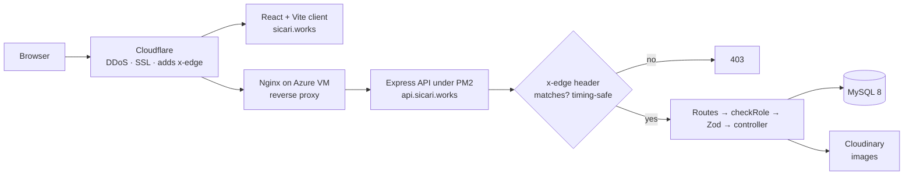
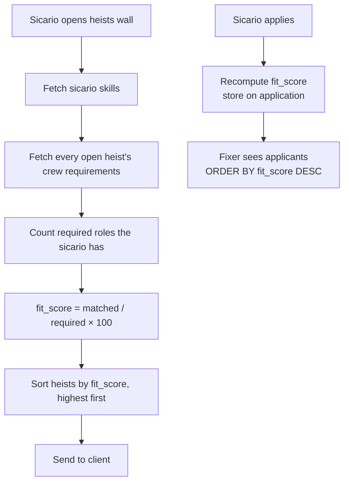
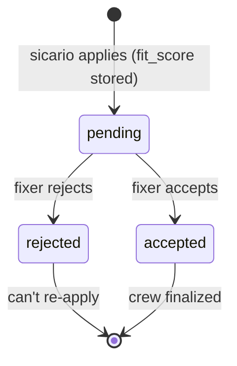

<div align="center">

# SICARI.WORKS

**A role-based job board with server-side skill matching**

*A full-stack matching platform dressed up as an underground Las Vegas job board*

**Built at Hacknite, IIIT Bangalore**

[Live site](https://sicari.works) · [API](https://api.sicari.works) · [Demo video](https://www.youtube.com/watch?v=u5YXOgA7ayc) · [API routes](#api-routes)

<!-- Screenshot placeholder: add docs/images/heists-wall.png (the heists wall or the newspaper feed) and uncomment

-->

<p>
  
  
  
  
  
  
  
</p>

</div>

---

## Overview

Sicari.works connects two kinds of users. **Fixers** post jobs ("heists") listing the crew roles they need.
**Sicarios** build a profile with their skills and apply. The theme is a 1950s crime syndicate: a typewriter profile
editor, a newspaper feed, wanted posters and a heists wall. Underneath it's an ordinary role-based web app: separate
permissions per role, server-side matching, file uploads, a social graph and a voted feed.

The server does the matching itself. When a sicario opens the heists wall, every open heist is scored against their
skills and the list is sorted before it's sent. When they apply, the score is saved on the application, and the
fixer sees applicants ranked by it. The sicario never sees their own score.

For each sicario, the app:

1. Stores their skills, picked from a list of 20 roles (Hacker, Driver, Safecracker, Cryptographer…).
2. Scores each open heist by how many of its required crew roles they cover.
3. Returns the heists wall sorted by that score, best fit first.
4. Saves the score on the application when they apply, with the status `pending`.
5. Shows the fixer every applicant ranked by score, and lets them accept or reject.
6. Shows the sicario only the status of each application.

## Features

| Capability | Description |
|---|---|
| Two roles | Fixer and sicario, set at signup (strict enum) and checked on every protected route |
| Matching engine | Required roles vs the sicario's skills → fit score 0-100%, computed and sorted on the server |
| Heists | Fixers post multi-section heist dossiers with up to 3 photos; sicarios apply in one click |
| Applications | `pending` → `accepted` / `rejected`; one application per heist (a second attempt gets 409) |
| Connections | Send, accept, decline, withdraw; public profiles show connection status and count |
| Newspaper feed | Posts with optional title and photo, Reddit-style up/down votes with toggle |
| Image uploads | Cloudinary, 5 MB limit per file, separate folders per upload type |
| Auth | JWT in an HttpOnly cookie, bcrypt with 12 rounds |
| Edge guard | In production the API only answers requests carrying Cloudflare's secret header, compared in constant time |

---

## What makes it different

1. **The score is decided on the server.** The client never computes or sends a fit score, so it can't be faked. The heists wall arrives already sorted.
2. **Applicants don't see their own score.** It's saved on the application for the fixer's ranking only. The sicario sees just the status.
3. **The API can't be reached around Cloudflare.** In production, any request without the right `x-edge` header gets a 403, so hitting the origin server directly doesn't work.
4. **Old passwords get upgraded on login.** If a stored password isn't a bcrypt hash yet, a successful login re-hashes it with bcrypt automatically.

---

## Architecture

### System



### Matching engine



### Application lifecycle



---

## Tech Stack

| Area | Technology |
|---|---|
| Frontend | React, Vite, React Router, Typed.js |
| Backend | Node.js, Express |
| Database | MySQL 8, parameterized queries only |
| Images | Cloudinary via multer (memory storage, 5 MB limit) |
| Auth | JWT in HttpOnly cookies, bcrypt (12 rounds) |
| Validation | Zod on request bodies, `sanitize-html` on user text |
| Hardening | helmet, CORS allowlist, Cloudflare edge secret |
| Edge | Cloudflare (DDoS, SSL, layer-7 protection) |
| Hosting | Self-hosted Azure VM, Nginx reverse proxy, PM2 process manager |
| CI/CD | GitHub Actions |

---

## Deep Dive: The Layers

### Layer 1: request path

Every API request goes through the same steps:

1. **CORS:** only `sicari.works`, `www.sicari.works` and, in development, localhost origins are allowed, with credentials.
2. **helmet:** sets security headers and hides the Express fingerprint.
3. **Edge guard:** in production, compares the `x-edge` header to `EDGE_SECRET` with `crypto.timingSafeEqual`. Missing or wrong → 403. `OPTIONS` preflights pass through so CORS still works.
4. **Auth:** reads the JWT from the HttpOnly cookie.
5. **`checkRole()`:** rejects a fixer calling a sicario route and the other way round.
6. **Zod:** validates the body before the controller runs. Role is a strict enum, lengths are capped.
7. **Controller:** sanitizes text with `sanitize-html` and runs parameterized MySQL queries.

> **Decision:** the token lives in an HttpOnly cookie, not `localStorage`. Page JavaScript can't read it, so an XSS
> bug can't steal the session.

### Layer 2: the matching score

For a heist with required roles *R* and a sicario with skills *S*:

$$\text{fit score} = \text{round}\left(100 \cdot \frac{|R \cap S|}{|R|}\right)$$

Matching ignores case. A heist with no listed roles scores 0. The score is computed when the heists wall loads and
again when the sicario applies, and only the second one is stored.

### Layer 3: data model

Tables are created on first start by `initDatabase()`, with no separate migrations:

| Table | Holds |
|---|---|
| `users` | username, bcrypt hash, role |
| `sicario_profiles` | dossier fields, skills, photo |
| `heists` | the fixer's multi-section dossier, crew requirements, status |
| `applications` | heist, sicario, `fit_score`, status |
| `connections` | requester, receiver, status |
| `newspaper_posts` / `post_votes` | feed posts and one vote per user per post |

---

## API Routes

### `/api/auth`

| Method | Route | Description |
|---|---|---|
| POST | `/register` | role: `sicario` or `fixer` |
| POST | `/login` | role must match the registered role |
| POST | `/logout` | clears the JWT cookie |
| POST | `/check-user` | does this username exist |
| GET | `/me` | logged-in user |

### `/api/posts`

| Method | Route | Description |
|---|---|---|
| GET | `/` | feed with upvotes, downvotes, score, `my_vote` |
| POST | `/add` | content (required), title and photo (optional) |
| POST | `/:id/vote` | toggle vote, `1` or `-1` |

### `/api/sicario`

| Method | Route | Description |
|---|---|---|
| GET / PUT | `/profile` | own profile (+ `connection_count`); update with optional photo |
| GET | `/heists` | open heists sorted by fit score |
| POST | `/apply/:heistId` | one-click apply |
| GET | `/applications` | own applications and status |

### `/api/fixer`

| Method | Route | Description |
|---|---|---|
| GET / PUT | `/profile` | own profile (+ `connection_count`); update with optional photo |
| POST | `/heist/add` | post a heist with up to 3 photos |
| GET | `/heists` | own heists only |
| GET | `/heist/:id/applicants` | applicants ranked by fit score |
| PATCH | `/application/:id` | `accepted` or `rejected` |

### `/api/connections`

| Method | Route | Description |
|---|---|---|
| POST | `/request/:userId` | send a request |
| PATCH | `/:id/accept` · `/:id/decline` | receiver only |
| DELETE | `/:id` | unfriend or withdraw |
| GET | `/` · `/pending` · `/sent` | accepted, incoming, outgoing |

### `/api/profile`

| Method | Route | Description |
|---|---|---|
| GET | `/:username` | public profile with `connection_status` (`none` · `sent` · `received` · `connected` · `declined`) and `connection_count` |

---

## Project Structure

```
client/
  src/pages/        heists wall, newspaper, network, connections, add heist/post, edit profile, my heists
  src/components/   wanted posters, dossier cards, polaroids, slide deck, transitions, background music
  src/utils/        dossier form mapping and normalization
  vercel.json       SPA rewrites
server/
  index.js          entry point
  src/app.js        CORS, helmet, edge guard, route mounting
  src/routes/       auth, posts, sicario, fixer, connections, profile
  src/controllers/  request handlers and the matching engine
  src/middleware/   auth, checkRole, Zod validation, uploads
  src/utils/        Cloudinary, sanitize
  src/db.js         MySQL pool and table creation
```

---

## Deployment

The API is self-hosted on an Azure VM:

- **Cloudflare** sits in front for DNS, SSL and DDoS protection, and adds the secret `x-edge` header the API checks.
- **Nginx** on the VM is the reverse proxy in front of the Node process.
- **PM2** keeps the Express server running and restarts it if it crashes.
- **GitHub Actions** handles CI/CD.

---

## Installation

```bash
git clone https://github.com/ArushJain-697/Hacknite.git && cd Hacknite
```

**Backend**

```bash
cd server
npm install
npm run dev      # nodemon, development
npm start        # production
```

**Frontend**

```bash
cd client
npm install
npm run dev      # Vite dev server
npm run build    # production build
```

Create `server/.env`:

```
MYSQLHOST=
MYSQLPORT=3306
MYSQLUSER=
MYSQLPASSWORD=
MYSQLDATABASE=
JWT_SECRET=
CLOUDINARY_CLOUD_NAME=
CLOUDINARY_API_KEY=
CLOUDINARY_API_SECRET=
EDGE_SECRET=          # production only: must match the header Cloudflare adds
PORT=8080
NODE_ENV=production
FRONTEND_URL=https://sicari.works
```

Tables are created on the first run. With `NODE_ENV` not set to `production`, the edge guard is off and localhost
origins are allowed, so local development needs no Cloudflare setup.

---

## Glossary

| Term | Meaning |
|---|---|
| Fixer | User who posts heists (jobs) and picks a crew |
| Sicario | User who builds a skill profile and applies to heists |
| Heist | A job posting with required crew roles |
| Fit score | Percentage of a heist's required roles the sicario has |
| Edge guard | Middleware that rejects requests not coming through Cloudflare |
| HttpOnly cookie | A cookie page JavaScript can't read |
| Timing-safe compare | Comparing secrets in constant time so response timing doesn't leak them |

---

## Team

Built at Hacknite, IIIT Bangalore.

- Ayaan Sharma
- Arush Kumar Jain
- Yug Porwal

*Started as random whiteboard scribbles, turned into long "bhai this won't work" debates and somehow ended up as a system that actually does.*

